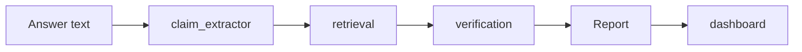

# AI Hallucination Detector

Verifies AI-generated answers against trusted evidence. Extracts factual claims from an answer, retrieves supporting or refuting passages, and scores each claim with a natural-language-inference (NLI) model. A claim the evidence cannot support is flagged, not silently trusted.

## How it works



- **Extract** — the answer is split into atomic, checkable claims. Opinions, questions, and greetings are filtered out.
- **Retrieve** — for each claim, candidate evidence passages are fetched from live Wikipedia, with a built-in static corpus as offline fallback.
- **Verify** — each claim is scored against its evidence with an NLI model (entailment / contradiction / neutral) plus embedding similarity.
- **Report** — per-claim verdicts and one hallucination score for the answer.

## Architecture

| Module | Owner | Contents | Contract |
|---|---|---|---|
| `verification/` | Abhi | NLI + embedding models, verify_claim, run_pipeline, integration | `verify_claim(claim, evidence) -> Verdict` · `run_pipeline(answer_text, live=True) -> Report` |
| `retrieval/` | Ishan | Static corpus, BM25 + FAISS indexes, live Wikipedia search | `retrieve_evidence(claim_text, k=5, live=False) -> list[Evidence]` |
| `claim_extractor/` | Varun | Sentence splitting, claim filtering, decontextualization | `extract_claims(answer_text) -> list[Claim]` |
| `dashboard/` | Divyansh (UI) | Flask app, templates, history | HTTP routes (see below); calls only `run_pipeline` |

### Data shapes (fixed contracts — do not change them without team agreement):

```python
Claim = {"claim_id": str, "text": str}
Evidence = {"text": str, "source_title": str, "source_url": str, "score": float}
Verdict = {"claim_id": str, "label": "SUPPORTED" | "CONTRADICTED" | "UNVERIFIED", "confidence": float, "evidence": list[Evidence]}
Report = {"verdicts": list[Verdict], "hallucination_score": float}
```

## Verification logic

- **Models (loaded once, CPU)**: `MoritzLaurer/DeBERTa-v3-base-mnli-fever-anli` for NLI and `sentence-transformers/all-MiniLM-L6-v2` for embeddings.
- For each claim, every retrieved passage is scored by the NLI model.
- The verdict is decided from the strongest passage scores:
  - **CONTRADICTED** — if max contradiction score >= 0.60.
  - **SUPPORTED** — else if max entailment >= 0.60 and the best entailing passage has embedding similarity >= 0.40.
  - **UNVERIFIED** — otherwise. Confidence is 0.3 when no usable evidence survives retrieval (see filter below).

**Hallucination score for the whole answer**:
```text
score = (contradicted + 0.5 * unverified) / total_claims * 100
```
`CONTRADICTED` counts fully, `UNVERIFIED` counts half, `SUPPORTED` counts zero. An answer with no extractable claims scores `0.0`.

## Retrieval

Two sources, one interface:

1. **Live Wikipedia** (`retrieval/live_search.py`, used when `live=True`). Queries the MediaWiki API (`action=query&list=search`) with the claim text, takes the top 3 articles, fetches plain-text extracts (`prop=extracts&explaintext=1`), splits them into 3–5 sentence passages, and ranks by raw cosine similarity to the claim. Fetched articles are cached under `retrieval/data/wiki_cache/` for offline reuse. Requests use a project User-Agent and a 10-second timeout.
2. **Static corpus** (`retrieval/data/corpus.json`, 390 Wikipedia passages). Hybrid lexical + semantic search: BM25 (`rank-bm25`) over an inverted index plus FAISS embedding search. This is the fallback when a live lookup fails, times out, or returns nothing — and the only source used by the deterministic tests.

**Evidence filter**: Passages whose raw similarity to the claim is below 0.5 are dropped before verification. If none survive, the claim is `UNVERIFIED` with no evidence shown. Scores returned by live retrieval are raw cosine similarities, not rank-normalized values.

## Claim extraction

`claim_extractor/` splits the answer with spaCy (regex fallback if the model is unavailable), filters opinion / question / greeting sentences, splits compound sentences, and decontextualizes leading pronouns so each claim stands alone. Claim IDs are normalized to strings by the pipeline.

## Dashboard

Flask app (`python run_dashboard.py` → [http://127.0.0.1:5000](http://127.0.0.1:5000)).
Models warm up once at startup; later checks reuse them.

| Route | Purpose |
|---|---|
| `GET /` | Paste-answer form |
| `POST /check` | Runs `run_pipeline` (`live=True`), renders results |
| `GET /history` | Past checks from SQLite, newest first |
| `GET /history/<id>`, `GET /results/<id>` | Re-view a past check |
| `POST /history/<id>/delete` | Delete a saved check |

Results show each claim with its verdict, confidence, and retrieved evidence, plus a fingerprint summary (evidence coverage, contradiction rate, profile, recommended next step). History is stored in `dashboard/hallucination_history.db`. This is a development server — do not use it in production.

## Quickstart

```powershell
git clone https://github.com/abhishek-the-goat/ai-hallucination-detector.git
cd ai-hallucination-detector
python -m venv .venv
.\.venv\Scripts\Activate.ps1
pip install -r requirements.txt
```

```powershell
python -m pytest tests/ -q               # full test suite
python -m verification.test_mock          # deterministic Eiffel Tower baseline (static corpus)
python run_dashboard.py                   # dashboard at http://127.0.0.1:5000
```

First run downloads the models (~400 MB) and builds the static index; later runs load from cache. If model downloads are unavailable, set `$env:HF_HUB_OFFLINE=1` to load from cache without retry delays.

## Example

**Input**:
```text
The Eiffel Tower is in Berlin. The Eiffel Tower was built in 1889. The Eiffel Tower is 500 metres tall.
```

**Output (static-corpus baseline, `live=False`)**:
```text
Claim 1: CONTRADICTED (0.999) — Berlin
Claim 2: SUPPORTED (0.976) — built in 1889
Claim 3: CONTRADICTED (0.999) — 500 metres
Hallucination score: 66.67
```

With live retrieval, `"The Taj Mahal is located in China."` returns Taj Mahal passages from `en.wikipedia.org/wiki/Taj_Mahal` and is marked `CONTRADICTED` — the system checks the live article for the claim, not a pre-fed passage set.

## Project structure

```text
verification/      models.py, engine.py, pipeline.py, test_mock.py, test_edge.py
retrieval/         corpus.py, index.py, search.py, live_search.py, data/corpus.json
claim_extractor/   extractor.py, filters.py, ai_input.py
dashboard/         app.py, templates/, static/, hallucination_history.db
tests/             test_retrieval.py, ...
requirements.txt
run_dashboard.py
```

## Tests and CI

- `pytest tests/ -q` — 79 tests, all green. Covers retrieval (hybrid search, live lookup, caching, fallback), the pipeline baseline, and edge cases (empty input, empty evidence, unrelated claims).
- `verification/test_mock.py` — deterministic baseline: it runs with `live=False` so the expected verdicts (`66.67`) never depend on live Wikipedia content.
- `verification/test_edge.py` — edge cases: empty evidence → `UNVERIFIED` (0.3), unrelated claim vs. unrelated evidence → `UNVERIFIED`, empty text → score `0.0` without crashing.
- `main` is branch-protected: changes land via pull request, the build check must pass, and the branch must be up to date. No bypassing.

## Limitations

- **Evidence quality bounds verdict quality**. The static corpus covers a small set of articles; anything outside it verifies as `UNVERIFIED` unless live retrieval is on and reachable.
- **The verdict rule is contradiction-first**: a single passage scoring contradiction >= 0.60 decides the claim even if other passages entail it (e.g. "built from 1887 to 1889" reads as contradicting "built in 1889"). This is conservative by design; changing the aggregation rule is a deliberate decision, not a drive-by fix.
- **Live retrieval needs internet access** to `en.wikipedia.org` and adds per-claim latency (search + fetch + embed). The wiki cache softens repeat queries.
- **Runs on CPU**. First startup is slow (model load + index build).

## Contributing

- One folder per person, one branch per change, fixed module contracts.
- Do not regenerate another member's files.
- Do not change the `Claim` / `Evidence` / `Verdict` / `Report` shapes without team agreement — the pipeline, dashboard, and tests all depend on them.
- The repo owner merges all pull requests, after CI is green.

## Team

| Member | Responsibility |
|---|---|
| Abhishek Thakur | Verification engine, pipeline, integration |
| Ishan Kaushal | Retrieval engine (static + live) |
| Varun Jaiswal | Claim extractor |
| Divyansh Sood | Dashboard UI |
